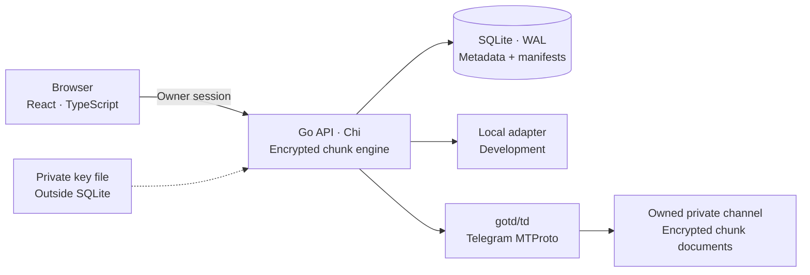

<picture>
  <source media="(prefers-color-scheme: dark)" srcset="docs/assets/harbor-banner-dark.svg">
  
</picture>

<h1 align="center">Harbor</h1>

<p align="center"><strong>Your files. Your cloud. Powered by Telegram.</strong></p>

<p align="center">A self-hosted, single-owner cloud drive with encrypted Telegram storage,<br>resumable transfers, and a thoughtful file manager.</p>

<p align="center">
  <a href="https://github.com/seakleangnhak/harbor/releases/tag/v1.0.1"></a>
  <a href="LICENSE"></a>
  <a href="docs/KNOWN_LIMITATIONS.md"></a>
</p>

<p align="center">
  <a href="#get-started">Get started</a> ·
  <a href="#connect-telegram">Telegram setup</a> ·
  <a href="docs/RECOVERY_QUICKSTART.md">Recovery</a> ·
  <a href="CONTRIBUTING.md">Contribute</a> ·
  <a href="docs/GHCR_PUBLISHING_GUIDE.md">Releases</a>
</p>

<picture>
  <source media="(prefers-color-scheme: dark)" srcset="docs/assets/file-manager-dark.webp">
  
</picture>

*Actual application, generated demonstration files, local encrypted adapter. [Screenshot provenance](docs/assets/README.md).*

## Your workspace, on your terms

Distribution starts from a [reviewed source snapshot](docs/PUBLIC_REPOSITORY_PLAN.md). Earlier v1.0.0 reports describe a separate private development history; its commits, tag and local artifacts are not imported. First private GitHub/GHCR release: **[v1.0.1](https://github.com/seakleangnhak/harbor/releases/tag/v1.0.1)**. Tagged CI and independent AMD64/ARM64 registry qualification passed. Original publishing run failed its package-metadata check; follow-up read-only verification passed without changing tag or image. [Exact results and digest](docs/GHCR_RELEASE_REPORT.md). Public visibility requires separate approval. [Earlier main/PR CI](docs/REMOTE_VALIDATION_REPORT.md). [Publication gate](docs/PUBLICATION_GO_NO_GO.md) · [First release](docs/FIRST_GITHUB_RELEASE.md).

Harbor keeps your file organization and encryption keys on a host you control. Telegram holds authenticated, encrypted chunks; a lightweight Go server connects them to a familiar file manager. A local storage adapter runs the same flow without Telegram credentials, making development and recovery testing practical.

Built for one owner. No public signup, sharing links, or extra infrastructure to operate. **v1.0.0 passed local personal-use qualification**, including live Telegram, multipart integrity, container recreation, and encrypted restoration into a fresh environment. This is not an independent security audit or public-internet deployment qualification. [Evidence and scope](docs/PHASE6_FINAL_REPORT.md).

## What Harbor does

| A clear file manager | Storage you can inspect and recover |
| --- | --- |
| Nested folders, breadcrumbs, search, sorting, favorites and recent files | Telegram MTProto storage through your dedicated account and owned private channel |
| Dense list and thumbnail grid, multi-selection, context menus and clipboard actions | AES-256-GCM chunks with SHA-256 verification before completed files appear |
| Image, PDF, text/code, audio and browser-supported video previews | Resumable multipart uploads with durable server acknowledgements |
| Responsive layouts, light/dark themes, keyboard shortcuts and command palette | Transfer history, retries, cancellation and supported pause/resume |
| Trash and recovery, details inspector, persistent folder preferences | Encrypted offline recovery archives and restart-safe folder-copy jobs |

<details>
<summary><strong>Explore previews, transfers and mobile</strong></summary>

<table>
  <tr>
    <td width="50%"><a href="docs/assets/image-preview.webp"></a><br><strong>Images</strong> — zoom, pan and nearby-file navigation.</td>
    <td width="50%"><a href="docs/assets/pdf-preview.webp"></a><br><strong>Documents</strong> — PDF pages and bounded text/code previews.</td>
  </tr>
  <tr>
    <td width="50%"><a href="docs/assets/transfer-history.webp"></a><br><strong>Transfers</strong> — acknowledged progress and verified completion.</td>
    <td width="50%" align="center"><a href="docs/assets/mobile.webp"></a><br><strong>Mobile</strong> — purpose-built navigation and touch controls.</td>
  </tr>
</table>

</details>

## Get started

Use a fresh checkout and a trusted local machine. The default adapter is **local**; no Telegram account is needed to try Harbor. Do not replace an existing `.env`, data directory, content key or session.

### Docker Compose

Requires Docker with Compose v2 and Buildx. Cold Telegram compilation needs several GiB of RAM; build one architecture at a time on constrained machines. Compose limits the running service to 2 CPUs and 768 MiB. Run from the repository root:

```sh
test -e .env || cp .env.example .env
chmod 600 .env
docker compose -p harbor-local build
docker compose -p harbor-local run --rm drive init
docker compose -p harbor-local run --rm drive password
docker compose -p harbor-local up -d
docker compose -p harbor-local ps
```

Open **[http://127.0.0.1:8080](http://127.0.0.1:8080)** and sign in with the password displayed in your local Terminal. There is no default password. `password` requires an interactive terminal; initialization generates private key/password files and never replaces existing ones.

Compose publishes only on loopback. Its non-root, read-only container keeps SQLite, encryption key, password and session in the persistent `harbor-local_drive-data` volume. Keep the same Compose project name for later restarts. **Do not use `docker compose down -v` on a drive you want to keep.** Use `DRIVE_PORT` in `.env` to change the host port.

This quickstart builds from source. A [private GHCR package](https://github.com/users/seakleangnhak/packages/container/package/harbor) is also available for AMD64 and ARM64. With an already authorized GHCR client, pull the qualified immutable image:

```sh
docker pull ghcr.io/seakleangnhak/harbor@sha256:d5c56ecd655e83f298e63f3e97f7df7582aecd9ebdd45b0d6aed6801b36bc855
```

Version tag `1.0.1`, minor `1.0` and `latest` resolve to this index at release qualification; prefer the digest for deployment. Keep existing volume identity and recovery material when using a trusted-image override. [Operations](docs/PRODUCTION_OPERATIONS.md) · [Publishing and image verification](docs/GHCR_PUBLISHING_GUIDE.md).

For Dokploy, use the image-only [Compose template](compose.dokploy.yaml) and [deployment guide](docs/DOKPLOY.md). It keeps one instance, an external data volume and HTTPS routing configured through Dokploy.

### Local development

Requires Go **1.26.10+**, Node.js **24+**, and npm. macOS and Linux are supported. Python 3.11+ runs acceptance/recovery helpers; reproducible release packaging needs Python 3.12+ and Docker Buildx.

```sh
(cd web && npm ci && npm run build)
go run ./cmd/drive init
go run ./cmd/drive password
go run ./cmd/drive
```

The same local address serves the API and production frontend. For frontend development, run `npm run dev` in `web` alongside Go; Vite proxies API requests to port 8080. Default Go builds use the local adapter. Telegram commands need `-tags telegram`.

## Connect Telegram

Use a **dedicated Telegram account** and an **owned private channel** with auto-delete disabled and no linked discussion. Obtain your own API credentials from [my.telegram.org/apps](https://my.telegram.org/apps). Keep credentials, private channel links, QR codes and session files out of screenshots, issue reports and browser configuration.

1. Edit private `.env`: set `TELEGRAM_APP_ID`, `TELEGRAM_APP_HASH`, `USERNAME_OR_CHANNEL_LINK`, and `DRIVE_STORAGE=telegram`. Set `TELEGRAM_CHANNEL_ID` too when known; it guards against resolving the wrong channel.
2. Use a new drive/project. A drive is permanently bound to its original adapter, key and channel. Stop the local demo or choose another `DRIVE_PORT` first.
3. Initialize and authorize from an interactive local Terminal:

   ```sh
   docker compose -p harbor-telegram build
   docker compose -p harbor-telegram run --rm drive init
   docker compose -p harbor-telegram run --rm drive telegram-setup-qr
   docker compose -p harbor-telegram run --rm drive password
   docker compose -p harbor-telegram up -d
   ```

4. In the dedicated account, open **Settings → Devices → Link Desktop Device**, scan the Terminal QR, and approve. Enter any two-step password only in Terminal. Setup verifies channel ownership and retention before storage starts.

With a private channel link, Harbor resolves the access hash internally. Leave `TELEGRAM_CHANNEL_ACCESS_HASH` absent/empty. Invite links and copied private-message links are supported; the account must already own the channel. Setup does not join through an invite. Public `@username` channels are rejected. Positive MTProto IDs and valid Bot API channel IDs are accepted as the optional expected ID.

<details>
<summary>Native setup, phone login and channel discovery</summary>

Use an independent data directory for a native Telegram drive:

```sh
export DRIVE_DATA_DIR=./data-telegram
export DRIVE_STORAGE=telegram
go run -tags telegram ./cmd/drive init
go run -tags telegram ./cmd/drive telegram-setup-qr
go run -tags telegram ./cmd/drive password
go run -tags telegram ./cmd/drive
```

`telegram-setup` offers phone/code login instead of QR. Phone digits are visible locally; codes/passwords remain hidden. Follow the delivery method reported by Telegram. No automatic resend occurs; unsupported delivery methods stop safely. `flood_wait` means wait before retrying. Telegram test datacenters cannot access a real account's files.

`telegram-channels` lists eligible owned private channels and their ID/access-hash pair in an interactive Terminal. For this legacy numeric mode, clear `USERNAME_OR_CHANNEL_LINK`, then configure both `TELEGRAM_CHANNEL_ID` and `TELEGRAM_CHANNEL_ACCESS_HASH`. Do not combine an access hash with a link. With neither selector configured, setup can create a private storage channel; keep the resulting server-side configuration private.

Stop the server before setup/discovery; the CLI takes its exclusive data lock. Compose keeps its own `/data` state and does not forward host key/data/session paths. Authenticate inside the intended project's volume. **Never run original and copied Telegram authorizations simultaneously.**

</details>

## Configuration

Start with [`.env.example`](.env.example). Go loads a private regular `.env` from its working directory; mode `0600` is required. Values are literal, without shell execution or variable interpolation. Process environment takes priority. Compose substitutes `.env` values and explicitly forwards runtime Telegram settings. Never use `VITE_` for secrets or pass runtime credentials as Docker build arguments.

| Variable | Default | Purpose |
| --- | --- | --- |
| `DRIVE_STORAGE` | `local` | Adapter: `local` or `telegram`; bound on first server start |
| `DRIVE_ADDR` | `127.0.0.1:8080` | Native HTTP listener |
| `DRIVE_PORT` | `8080` | Compose host port; native binary uses `DRIVE_ADDR` |
| `DRIVE_DATA_DIR` | `data` | Native private state directory; Compose uses its `/data` volume |
| `DRIVE_KEY_FILE` | `<data>/content.key` | Original 32-byte content key; never replace for an existing drive |
| `DRIVE_OWNER_PASSWORD_FILE` | `<data>/owner-password` | Generated first-owner password; later changes do not reset the owner |
| `DRIVE_STATIC_DIR` | `web/dist` | Production frontend; supplied by the Docker image |
| `DRIVE_ENV_FILE` | `.env` | Override configuration file; `-` disables implicit loading |
| `DRIVE_SECURE_COOKIES` | `false` | Enable with deliberately configured HTTPS |
| `TELEGRAM_APP_ID`, `TELEGRAM_APP_HASH` | unset | Dedicated account's server-side API application credentials |
| `USERNAME_OR_CHANNEL_LINK` | unset | Owned private channel selector; no manual access hash required |
| `TELEGRAM_CHANNEL_ID` | unset | Optional expected ID with a link; required in numeric-only mode |
| `TELEGRAM_SESSION_FILE` | `<data>/telegram.session` | Native MTProto authorization file, mode `0600` |

Keep state directories mode `0700`, secret files mode `0600`. Missing key, database or storage binding on an existing drive fails closed. Restore the original material; do not initialize over damaged state. [Operations](docs/PRODUCTION_OPERATIONS.md) covers additional settings, protected volumes, health/readiness, shutdown and HTTPS reverse proxies.

## Architecture



Files become independent **4 MiB** AES-256-GCM chunks with fresh nonces and authenticated chunk identities. SQLite stores ordered chunk references and SHA-256 digests. Finalization reads and verifies the complete file before publishing its metadata. Downloads verify chunks before releasing plaintext and support HTTP byte ranges for PDF/video seeking. Metadata changes do not rewrite file content.

One modular monolith serves UI/API and durable copy jobs. No Redis, external worker or object-storage service is required. Stack: Go/Chi, SQLite WAL, gotd/td, React, TypeScript, Vite, Tailwind CSS, Radix/shadcn primitives and TanStack Query/Virtual. [Architecture](docs/ARCHITECTURE.md) · [API contract](docs/API_CONTRACT.md).

## Backups and recovery

Harbor's offline recovery CLI creates **encrypted, versioned archives** containing a WAL-safe SQLite snapshot, content key, configuration, ordered manifests, and required session material. Local-adapter backups also contain referenced ciphertext. Stop Harbor before backup or restoration; keep the archive password independently.

```sh
go build -o bin/harbor-recovery ./cmd/harbor-recovery
mkdir -m 700 backups
# Harbor must be stopped. Use a new archive path.
bin/harbor-recovery backup --data-dir ./data \
  --output backups/harbor-recovery.harbor --config-file .env
bin/harbor-recovery verify --archive backups/harbor-recovery.harbor
```

Enter a high-entropy backup password in the hidden Terminal prompt. Automation uses a separate private `--password-file`, never a password argument or environment variable. The config file must describe the actual adapter/channel, including any runtime overrides. Docker backup requires access to the stopped project's private volume; follow the runbook rather than using the native `./data` example.

**A Telegram recovery archive does not mirror remote ciphertext.** Lost account/channel/messages require an independent protected content copy. Key loss without a usable archive, or loss of the archive password, has no recovery bypass.

Follow the [recovery quickstart](docs/RECOVERY_QUICKSTART.md) for off-host copies, fresh-directory restoration, clean-environment startup and download/checksum drills. The [operations runbook](docs/PRODUCTION_OPERATIONS.md) covers scheduled offline backups, session incidents, upgrades and rollback. Never run restored Telegram authorization alongside its original.

## Security model and limits

Harbor encrypts content on the server before storage. It is **not browser-to-browser end-to-end encryption**: the owner trusts the Harbor host, which handles plaintext, keys and sessions. Filenames, hierarchy, sizes and hashes remain readable in protected SQLite. Use host disk encryption and protect both session files and recovery archives.

Owner access uses password hashing, random revocable HttpOnly/SameSite cookies, same-origin mutation checks, bounded requests and login throttling. Default host/Compose access is loopback. Secure cookies do not provide TLS; any intentional remote deployment needs a separately tested HTTPS configuration. No independent security audit or public-internet qualification is claimed. [Responsible disclosure](SECURITY.md).

Practical boundaries:

- Telegram availability, account restrictions and retention remain outside Harbor's control. No unlimited-storage or durability guarantee.
- Live cross-datacenter retrieval is **NOT TESTED**. Deterministic migration/reference/recovery tests cover protocol handling.
- Uploads resume after reload by reselecting the original file. Managed downloads verify full size/SHA-256 up to **32 MiB**; larger files use browser downloads with backend chunk verification. Paused managed downloads restart.
- Folder-copy jobs are bounded to **10,000 entries**, 100 selected roots and depth 512, with one worker. Failed copies retain originals and recoverable state.
- Backup is offline with a **256 MiB SQLite** snapshot limit. No automatic remote garbage collection, content-key rotation or off-provider content mirror.
- Chromium/WebKit and emulated mobile coverage do not establish physical Safari/iOS, every codec or complete accessibility certification.

See [known limitations](docs/KNOWN_LIMITATIONS.md) before relying on Harbor for irreplaceable data.

## Verify a checkout

Ordinary tests use disposable local fixtures and controlled doubles, without Telegram credentials:

```sh
DRIVE_ENV_FILE=- go test ./...
DRIVE_ENV_FILE=- go test -race ./...
DRIVE_ENV_FILE=- go vet ./...
DRIVE_ENV_FILE=- go test -tags telegram ./...
(cd web && npm ci && npm test && npm run typecheck && npm run build)
go build -o bin/drive ./cmd/drive
python3 scripts/acceptance.py --binary bin/drive
python3 -m unittest discover -s scripts -p '*_test.py'
docker compose config --quiet
```

[CI checks](docs/GITHUB_ACTIONS_REPORT.md) explain automation and credential-free Docker smoke tests. [Release checklist](docs/RELEASE_CHECKLIST.md) and [v1.0 qualification](docs/PHASE6_FINAL_REPORT.md) distinguish tests actually run from unverified scenarios. Live harnesses require an explicitly verified target and private inputs; do not run them casually against a personal account.

For reproducible local packaging, `scripts/release.py` builds an explicit trusted committed ref, excludes untracked private state, and emits image/source archives with SHA-256 manifests. It never pushes or creates tags. [Release and GHCR guide](docs/GHCR_PUBLISHING_GUIDE.md).

## Troubleshooting

| Symptom | Next step |
| --- | --- |
| First login/password unclear | Run `drive password` or the matching Compose `run --rm drive password` in a local interactive Terminal. No default credentials exist. |
| HTTP 429 on login | Wait for the throttle window; repeated automated sign-ins count too. Do not disable protection. |
| `channel_mismatch` or `channel_retention` | Check link/expected ID and disable channel auto-delete. Keep target verification enabled. |
| Telegram code never arrives | Follow reported delivery method on an already signed-in dedicated account; use `telegram-setup-qr` instead of repeatedly requesting codes. |
| Upload waiting after bytes reach 100% | Finalization verifies every stored chunk before publishing. Keep the transfer active. |
| State/key permissions or missing binding error | Restore original private permissions/material. Never replace `content.key`, delete SQLite/WAL, or switch adapters to bypass startup. |
| Container recreation loses visible files | Check the original Compose project/volume identity. Stop before further changes and follow recovery guidance; never delete the volume. |

## Contribute and follow releases

Small, focused contributions with meaningful verification are welcome. Read [CONTRIBUTING.md](CONTRIBUTING.md), the [Code of Conduct](CODE_OF_CONDUCT.md), and [security policy](SECURITY.md) first. Use generated fixtures; never attach private files, credentials or real installation screenshots.

Original local release: **v1.0.0**. First approved automated private GitHub/GHCR release: **v1.0.1**; actual publication requires successful tagged CI and delivered-image verification. Existing tags stay immutable. [Changelog](CHANGELOG.md) · [publishing guide](docs/GHCR_PUBLISHING_GUIDE.md) · [open-source readiness](docs/OPEN_SOURCE_READINESS_REPORT.md).

Future work is driven by verified needs: legitimate live cross-DC qualification, broader browser/accessibility testing, recovery automation and independent security review. These are directions, not delivery promises.

## License and acknowledgements

Harbor is available under the [MIT License](LICENSE). Original lighthouse branding and generated demonstration assets are included; dependencies keep their own licenses. See [third-party notices](THIRD_PARTY_NOTICES.md) and [asset provenance](docs/assets/README.md).

[NimbusDrive](https://github.com/CRayuth/NimbusDrive) and [CamHost.space](https://github.com/peak-brosmao/CamHost.space-Open-Soucre) informed early architectural research. Their source, visual designs and assets were not copied; their README license claims were not treated as permission to reuse code. Harbor uses the independently licensed projects listed in its dependency manifests and notices. Harbor is not affiliated with or endorsed by Telegram.
