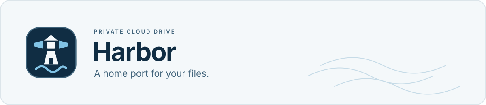
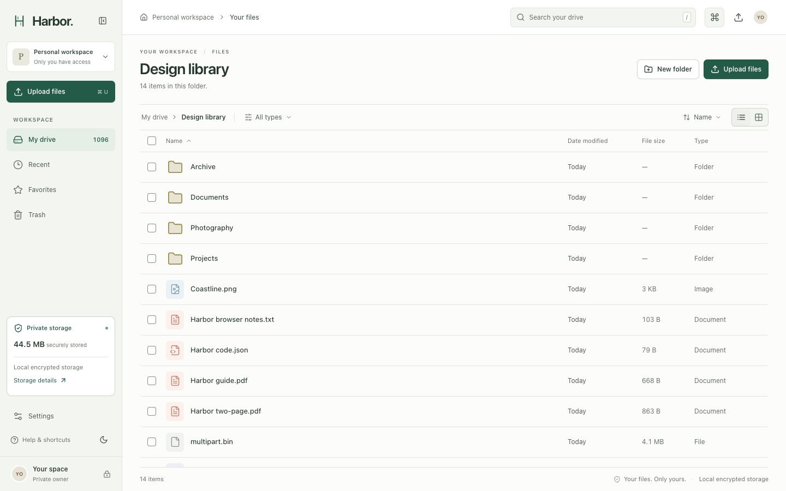
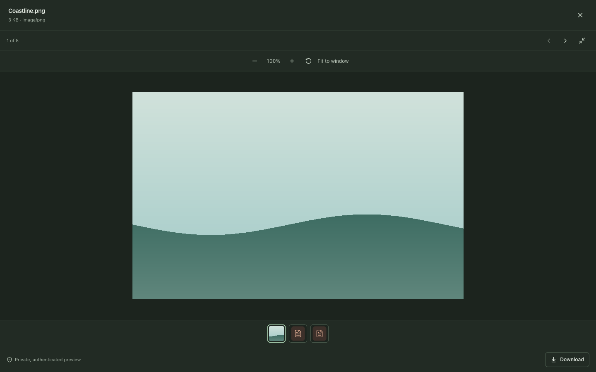
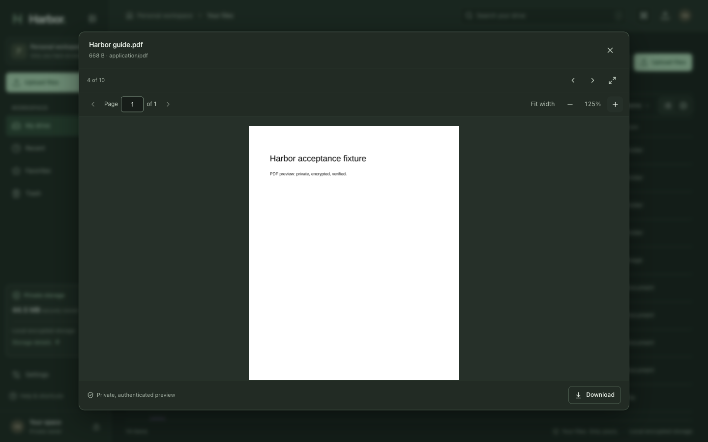
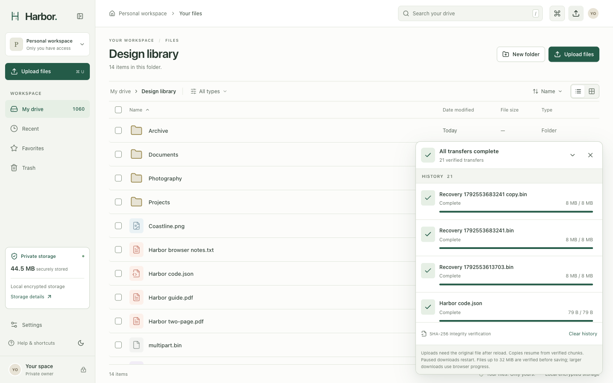
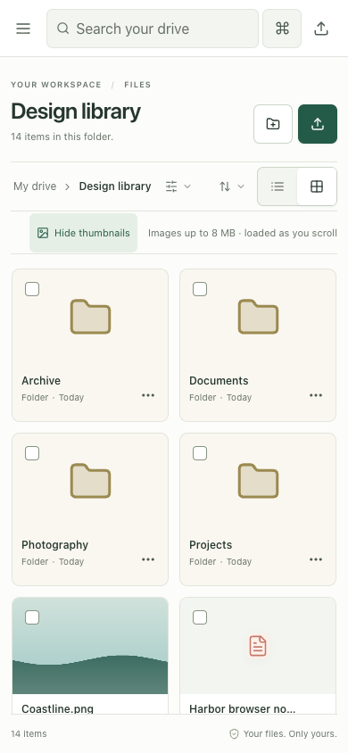
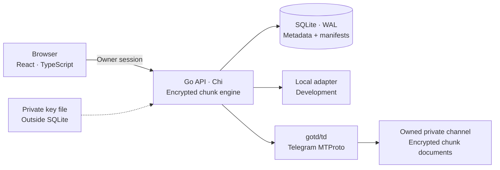

<picture>
  <source media="(prefers-color-scheme: dark)" srcset="docs/assets/harbor-banner-dark.svg">
  
</picture>

<h1 align="center">Harbor</h1>

<p align="center"><strong>Your files. Your cloud. Powered by Telegram.</strong></p>

<p align="center">A self-hosted, single-owner cloud drive with encrypted Telegram storage,<br>resumable transfers, and a thoughtful file manager.</p>

<p align="center">
  <a href="https://github.com/seakleangnhak/harbor/releases/tag/v1.2.1"></a>
  <a href="LICENSE"></a>
  <a href="docs/KNOWN_LIMITATIONS.md"></a>
</p>

<p align="center">
  <a href="#get-started">Get started</a> ·
  <a href="#connect-telegram">Telegram setup</a> ·
  <a href="docs/RECOVERY_QUICKSTART.md">Recovery</a> ·
  <a href="CONTRIBUTING.md">Contribute</a> ·
  <a href="docs/GHCR_PUBLISHING_GUIDE.md">Releases</a>
</p>

<picture>
  <source media="(prefers-color-scheme: dark)" srcset="docs/assets/file-manager-dark.webp">
  
</picture>

*Actual application, generated demonstration files, local encrypted adapter. [Screenshot provenance](docs/assets/README.md).*

## Your workspace, on your terms

Distribution uses a [reviewed source snapshot](docs/PUBLIC_REPOSITORY_PLAN.md); original private development history and runtime data are excluded. **v1.2.1** adds smaller resumable browser parts, repaired previews and owner account settings, preserving 100 MiB encrypted Telegram chunks. [Release qualification](docs/RELEASE_1.2.1.md) records checks and publication status; [v1.1.0 evidence](docs/RELEASE_1.1.0.md) remains historical.

Harbor keeps your file organization and encryption keys on a host you control. Telegram holds authenticated, encrypted chunks; a lightweight Go server connects them to a familiar file manager. A local storage adapter runs the same flow without Telegram credentials, making development and recovery testing practical.

Built for one owner. No public signup, sharing links, or extra infrastructure to operate. **v1.0.0 passed local personal-use qualification**, including live Telegram, multipart integrity, container recreation, and encrypted restoration into a fresh environment. This is not an independent security audit or public-internet deployment qualification. [Evidence and scope](docs/PHASE6_FINAL_REPORT.md).

**New installations start in the browser.** Supply a private setup token, choose your owner password, then connect Telegram or use local storage. Existing initialized drives retain their key, login, session and stored chunk geometry.

## What Harbor does

| A clear file manager | Storage you can inspect and recover |
| --- | --- |
| Nested folders, breadcrumbs, search, sorting, favorites and recent files | Telegram MTProto storage through your dedicated account and owned private channel |
| Dense list and thumbnail grid, multi-selection, context menus and clipboard actions | AES-256-GCM chunks with SHA-256 verification before completed files appear |
| Image, PDF, text/code, audio and browser-supported video previews | Resumable multipart uploads with durable server acknowledgements |
| Responsive layouts, light/dark themes, keyboard shortcuts and command palette | Guarded browser setup for owner password and Telegram QR authorization |
| Trash and recovery, details inspector, persistent folder preferences | Encrypted offline recovery archives and restart-safe folder-copy jobs |

<details>
<summary><strong>Explore previews, transfers and mobile</strong></summary>

<table>
  <tr>
    <td width="50%"><a href="docs/assets/image-preview.webp"></a><br><strong>Images</strong> — zoom, pan and nearby-file navigation.</td>
    <td width="50%"><a href="docs/assets/pdf-preview.webp"></a><br><strong>Documents</strong> — PDF pages and bounded text/code previews.</td>
  </tr>
  <tr>
    <td width="50%"><a href="docs/assets/transfer-history.webp"></a><br><strong>Transfers</strong> — acknowledged progress and verified completion.</td>
    <td width="50%" align="center"><a href="docs/assets/mobile.webp"></a><br><strong>Mobile</strong> — purpose-built navigation and touch controls.</td>
  </tr>
</table>

</details>

## Get started

Use a fresh checkout and a trusted local machine. Start Harbor, then create your owner password and choose Telegram or local storage in the browser. Local storage needs no Telegram account. Do not replace an existing `.env`, data directory, content key or session.

### Docker Compose

Requires Docker with Compose v2. Published images support AMD64 and ARM64; no Go or Node installation is needed. For v1.3.0, start with a **1 GiB container memory limit**, the existing **512 MiB Go soft limit**, and 2 CPUs. The shipped Compose limit remains 768 MiB; set `services.drive.mem_limit` to `1g` in your local deployment copy before starting. 768 MiB passed bounded tests but has no proven headroom; 1 GiB is an initial recommendation, not guaranteed spare capacity. [Memory and disk sizing](docs/PRODUCTION_OPERATIONS.md#protected-installation).

The commands below still pull published v1.2.1. v1.3.0 is locally qualified and awaits separate source/image publication approvals; see [release notes](docs/RELEASE_1.3.0.md) and [publication plan](docs/V1.3_PUBLICATION_PLAN.md). Run from the repository root:

```sh
export DRIVE_SETUP_TOKEN="$(openssl rand -hex 32)"
docker compose -p harbor-local up -d --no-build --pull always
printf 'Setup token: %s\n' "$DRIVE_SETUP_TOKEN"
docker compose -p harbor-local ps
```

Open **[http://127.0.0.1:8080](http://127.0.0.1:8080)**. Paste the setup token, choose your own owner password, and follow the storage setup. Telegram uses an in-browser QR and optional two-step password. No `init`, `password`, or terminal Telegram command is needed for a new installation. Keep the token private; it prevents another visitor from claiming setup.

Compose pulls `ghcr.io/seakleangnhak/harbor:1.2.1`, publishes only on loopback, and uses a non-root, read-only container. To build audited source instead, use `HARBOR_IMAGE=harbor:local docker compose -p harbor-local up -d --build`; the separate local tag keeps unpublished source distinct from the pulled release. Set `HARBOR_IMAGE` to an independently verified digest for an immutable deployment. SQLite, encryption key, owner credentials and Telegram session remain in the persistent `harbor-local_drive-data` volume. Keep the same Compose project name for later restarts. **Do not use `docker compose down -v` on a drive you want to keep.** Use `DRIVE_PORT` in your environment to change the host port. Existing initialized volumes keep their original login and storage.

For plain `docker run`, HTTPS/Dokploy configuration, persistent state and troubleshooting, use the [web onboarding guide](docs/WEB_ONBOARDING.md).

### Dokploy and existing drives

Use [compose.dokploy.yaml](compose.dokploy.yaml) with the [Dokploy guide](docs/DOKPLOY.md) for HTTPS routing and browser onboarding. Keep one instance and the existing persistent volume. Before upgrading an initialized drive, create a verified encrypted backup and retain its effective legacy environment configuration; never run initialization again.

Version 1.0.1 remains available with its older terminal setup and 4 MiB chunks. Version 1.1.0 resumes old uploads and reads existing files without re-encryption. New 100 MiB chunks can increase first-preview/Range latency. [Operations](docs/PRODUCTION_OPERATIONS.md) · [Publishing and image verification](docs/GHCR_PUBLISHING_GUIDE.md).


### Local development

Requires Go **1.26.10+**, Node.js **24+**, and npm. macOS and Linux are supported. Python 3.11+ runs acceptance/recovery helpers; reproducible release packaging also needs Docker Buildx.

```sh
(cd web && npm ci && npm run build)
export DRIVE_ENV_FILE=-
export DRIVE_DATA_DIR=./data-web
export DRIVE_SETUP_TOKEN="$(openssl rand -hex 32)"
printf 'Setup token: %s\n' "$DRIVE_SETUP_TOKEN"
go run -tags telegram ./cmd/drive
```

The same local address serves the API, onboarding and production frontend. `data-web` keeps this example separate from existing `data`; `DRIVE_ENV_FILE=-` avoids loading unrelated `.env` settings. For frontend development, run `npm run dev` in `web` alongside Go; Vite proxies API requests to port 8080. Default Go builds support local storage only. Use `-tags telegram` for browser Telegram setup.

## Account settings

Open **Settings → Account** to change your display name or password. Profile edits include save/cancel feedback. Password changes verify your current password before saving a new one, then sign out every web session. Sign in again with the new password. Use 12–72 UTF-8 bytes; non-ASCII characters may use multiple bytes. Your content key, files and Telegram connection stay unchanged. **Storage** shows connection diagnostics; **Recovery** contains server backup instructions.

Password changes save only a bcrypt hash in SQLite. Environment/setup password files initialize new accounts; editing them does not reset an existing account. After a password change, encrypted backups retain the active hash/profile and omit obsolete automatically discovered initialization passwords. After restore, sign in with the owner password active when that backup was created. Keep it in a password manager; Harbor has no email password-reset service.

## Connect Telegram

Use a **dedicated Telegram account** and an **owned private channel** with auto-delete disabled and no linked discussion. Obtain your own API credentials from [my.telegram.org/apps](https://my.telegram.org/apps).

1. Start a fresh installation using the Compose quickstart, then enter its private setup token and create your owner password.
2. Choose **Telegram**. Enter the API ID, API hash, and current private channel invite or message link. An expected channel ID is optional.
3. In your dedicated Telegram account, open **Settings → Devices → Link Desktop Device**, scan the browser QR, and approve. Enter any Telegram two-step password in the protected setup form.
4. Wait for **Private channel verified**, review setup, then open Harbor and sign in using your chosen owner password.

Use HTTPS for any remote browser connection; loopback HTTP is supported locally. Tokens and entered credentials stay in browser memory during setup, never URLs or browser storage. Saved API credentials/session stay on the server. Keep private links, QR codes and secrets out of screenshots and issue reports. A drive is permanently bound to its adapter, key and channel; onboarding cannot reset an existing drive.

With a private channel link, Harbor resolves the access hash internally. Leave `TELEGRAM_CHANNEL_ACCESS_HASH` absent/empty. Invite links and copied private-message links are supported; the account must already own the channel. Setup does not join through an invite. Public `@username` channels are rejected. Positive MTProto IDs and valid Bot API channel IDs are accepted as the optional expected ID.

<details>
<summary>Legacy terminal setup, phone login and channel discovery</summary>

Use an independent data directory for a native Telegram drive:

Set the API ID/hash and private channel selector in a mode-`0600` `.env` first. This explicit legacy path does not use the browser bootstrap token:

```sh
unset DRIVE_SETUP_TOKEN
export DRIVE_ENV_FILE=.env
export DRIVE_DATA_DIR=./data-telegram
export DRIVE_STORAGE=telegram
go run -tags telegram ./cmd/drive init
go run -tags telegram ./cmd/drive telegram-setup-qr
go run -tags telegram ./cmd/drive password
go run -tags telegram ./cmd/drive
```

`telegram-setup` offers phone/code login instead of QR. Phone digits are visible locally; codes/passwords remain hidden. Follow the delivery method reported by Telegram. No automatic resend occurs; unsupported delivery methods stop safely. `flood_wait` means wait before retrying. Telegram test datacenters cannot access a real account's files.

`telegram-channels` lists eligible owned private channels and their ID/access-hash pair in an interactive Terminal. For this legacy numeric mode, clear `USERNAME_OR_CHANNEL_LINK`, then configure both `TELEGRAM_CHANNEL_ID` and `TELEGRAM_CHANNEL_ACCESS_HASH`. Do not combine an access hash with a link. With neither selector configured, setup can create a private storage channel; keep the resulting server-side configuration private.

Stop the server before setup/discovery; the CLI takes its exclusive data lock. Compose keeps its own `/data` state and does not forward host key/data/session paths. Authenticate inside the intended project's volume. **Never run original and copied Telegram authorizations simultaneously.**

</details>

## Configuration

Fresh browser setup needs only `DRIVE_SETUP_TOKEN`; leave storage/password/Telegram overrides unset so the browser can select them. [`.env.example`](.env.example) contains the minimal starter settings; additional options are listed below and in the [web onboarding guide](docs/WEB_ONBOARDING.md). Go loads a private regular `.env` from its working directory; mode `0600` is required. Values are literal, without shell execution or variable interpolation. Process environment takes priority; the saved web bundle fills unset values. Conflicting storage/password/Telegram overrides reject setup. Never use `VITE_` for secrets or pass runtime credentials as Docker build arguments.

| Variable | Default | Purpose |
| --- | --- | --- |
| `DRIVE_SETUP_TOKEN` | unset | Random 32–256-character first-run secret; setup refuses an unprotected fresh installation |
| `DRIVE_STORAGE` | unset for setup | Browser chooses `local` or `telegram`; initialized legacy configuration remains supported |
| `DRIVE_ADDR` | `127.0.0.1:8080` | Native HTTP listener |
| `DRIVE_PORT` | `8080` | Compose host port; native binary uses `DRIVE_ADDR` |
| `DRIVE_DATA_DIR` | `data` | Native private state directory; Compose uses its `/data` volume |
| `DRIVE_KEY_FILE` | `<data>/content.key` | Original 32-byte content key; never replace for an existing drive |
| `DRIVE_OWNER_PASSWORD_FILE` | `<data>/owner-password` for legacy | Web setup uses `<data>/setup/owner-password`; changing files later does not reset the owner |
| `DRIVE_STATIC_DIR` | `web/dist` | Production frontend; supplied by the Docker image |
| `DRIVE_ENV_FILE` | `.env` | Override configuration file; `-` disables implicit loading |
| `DRIVE_SECURE_COOKIES` | `false` | Enable with deliberately configured HTTPS |
| `TELEGRAM_APP_ID`, `TELEGRAM_APP_HASH` | unset | Dedicated account's server-side API application credentials |
| `USERNAME_OR_CHANNEL_LINK` | unset | Owned private channel selector; no manual access hash required |
| `TELEGRAM_CHANNEL_ID` | unset | Optional expected ID with a link; required in numeric-only mode |
| `TELEGRAM_SESSION_FILE` | `<data>/telegram.session` for legacy | Web setup uses `<data>/setup/telegram.session`, mode `0600` |

Keep state directories mode `0700`, secret files mode `0600`. Missing key, database or storage binding on an existing drive fails closed. Restore the original material; do not initialize over damaged state. [Operations](docs/PRODUCTION_OPERATIONS.md) covers additional settings, protected volumes, health/readiness, shutdown and HTTPS reverse proxies.

## Architecture



New uploads use independent **100 MiB** AES-256-GCM chunks with fresh nonces and authenticated chunk identities. Existing 4 MiB files and resumable uploads keep their recorded geometry. This is a chunk size, not a total-file cap; the existing API ceiling remains 1 TiB. SQLite stores ordered chunk references and SHA-256 digests. Finalization verifies the complete file before publishing its metadata. Downloads authenticate whole chunks before releasing plaintext, then support HTTP byte ranges for PDF/video seeking. Larger chunks can increase first-preview latency. Metadata changes do not rewrite file content.

Version 1.2.1 separates browser transport from storage: resumable **4 MiB** client parts stage encrypted on disk, then commit as one **100 MiB** Telegram chunk (plus its existing 32-byte encryption envelope). Live sent progress, server acceptance and Telegram saving are separate states. Part retries resend at most 4 MiB; a failed storage commit retains accepted parts for retry. Pause/reload resumes from server state after reselecting the original file. Pending parts need temporary local disk space of up to one storage chunk per upload and are omitted from recovery archives; after restore, resume resends those missing parts.

Current source adds a bounded background saving pipeline: the browser sends the next chunk while Harbor saves an accepted chunk. At most two pending chunks per upload and four globally apply backpressure; they remain encrypted on disk. Pausing stops browser sending while queued backend saves continue. Final completion still requires remote readback and whole-file verification. A disposable encrypted read cache (two entries,256 MiB maximum) reduces repeated Telegram fetches for PDF/video ranges and repeated downloads; each read still authenticates and verifies its chunk. Cold previews still fetch a complete stored chunk. Local v1.3.0 preparation retains the published v1.2.1 image default. Transfer, preview and release evidence belongs in the [final qualification gate](docs/V1.3_RELEASE_FINAL_GATE.md); no new tag or publication is implied.

One modular monolith serves UI/API and durable copy jobs. No Redis, external worker or object-storage service is required. Stack: Go/Chi, SQLite WAL, gotd/td, React, TypeScript, Vite, Tailwind CSS, Radix/shadcn primitives and TanStack Query/Virtual. [Architecture](docs/ARCHITECTURE.md) · [API contract](docs/API_CONTRACT.md).

## Backups and recovery

Harbor's offline recovery CLI creates **encrypted, versioned archives** containing a WAL-safe SQLite snapshot, content key, configuration, ordered manifests, and required session material. Local-adapter backups also contain referenced ciphertext. Stop Harbor before backup or restoration; keep the archive password independently.

```sh
go build -o bin/harbor-recovery ./cmd/harbor-recovery
mkdir -m 700 backups
# Harbor must be stopped. Use a new archive path.
bin/harbor-recovery backup --data-dir ./data \
  --output backups/harbor-recovery.harbor
bin/harbor-recovery verify --archive backups/harbor-recovery.harbor
```

Enter a high-entropy backup password in the hidden Terminal prompt. Automation uses a separate private `--password-file`, never a password argument or environment variable. For browser-onboarded drives, omit `--config-file`: recovery detects the private `<data>/setup` bundle and its owner/session files. Legacy configuration requires an explicit config file describing the actual runtime adapter/channel. Docker backup requires access to the stopped project's private volume; follow the runbook rather than using the native `./data` example.

**A Telegram recovery archive does not mirror remote ciphertext.** Telegram is an external storage dependency, with no guaranteed independent content durability. Lost account/channel/messages require an independent protected content copy. Key loss without a usable archive, or loss of the archive password, has no recovery bypass.

Follow the [recovery quickstart](docs/RECOVERY_QUICKSTART.md) for off-host copies, fresh-directory restoration, clean-environment startup and download/checksum drills. The [operations runbook](docs/PRODUCTION_OPERATIONS.md) covers scheduled offline backups, session incidents, upgrades and rollback. Never run restored Telegram authorization alongside its original.

## Security model and limits

Harbor encrypts content on the server before storage. It is **not browser-to-browser end-to-end encryption**: the owner trusts the Harbor host, which handles plaintext, keys and sessions. Filenames, hierarchy, sizes and hashes remain readable in protected SQLite. Use host disk encryption and protect both session files and recovery archives.

Owner access uses password hashing, random revocable HttpOnly/SameSite cookies, same-origin mutation checks, bounded requests and login throttling. Default host/Compose access is loopback. Secure cookies do not provide TLS; any intentional remote deployment needs a separately tested HTTPS configuration. No independent security audit or public-internet qualification is claimed. [Responsible disclosure](SECURITY.md).

Practical boundaries:

- Telegram availability, account restrictions and retention remain outside Harbor's control. No unlimited-storage or durability guarantee.
- Live cross-datacenter retrieval is **NOT TESTED**. Deterministic migration/reference/recovery tests cover protocol handling.
- Uploads resume after reload by reselecting the original file. Managed downloads verify full size/SHA-256 up to **32 MiB**; larger files use browser downloads with backend chunk verification. Paused managed downloads restart.
- Folder-copy jobs are bounded to **10,000 entries**, 100 selected roots and depth 512, with one worker. Failed copies retain originals and recoverable state.
- Backup is offline with a **256 MiB SQLite** snapshot limit. No automatic remote garbage collection, content-key rotation or off-provider content mirror.
- Chromium/WebKit and emulated mobile coverage do not establish physical Safari/iOS, every codec or complete accessibility certification. HEIC/HEIF images and MOV video use native browser decoding; unsupported codecs offer retry and original download.

See [known limitations](docs/KNOWN_LIMITATIONS.md) before relying on Harbor for irreplaceable data.

[Current project state](docs/CURRENT_PROJECT_STATE.md) separates released v1.2.1, local unreleased transfer changes, fresh verification and development priorities.

## Verify a checkout

Ordinary tests use disposable local fixtures and controlled doubles, without Telegram credentials:

```sh
DRIVE_ENV_FILE=- go test ./...
DRIVE_ENV_FILE=- go test -race ./...
DRIVE_ENV_FILE=- go vet ./...
DRIVE_ENV_FILE=- go test -tags telegram ./...
(cd web && npm ci && npm test && npm run typecheck && npm run build)
go build -o bin/drive ./cmd/drive
python3 scripts/acceptance.py --binary bin/drive
python3 -m unittest discover -s scripts -p '*_test.py'
docker compose config --quiet
```

[CI checks](docs/GITHUB_ACTIONS_REPORT.md) explain automation and credential-free Docker smoke tests. [Release checklist](docs/RELEASE_CHECKLIST.md) and [v1.0 qualification](docs/PHASE6_FINAL_REPORT.md) distinguish tests actually run from unverified scenarios. Live harnesses require an explicitly verified target and private inputs; do not run them casually against a personal account.

For reproducible local packaging, `scripts/release.py` builds an explicit trusted committed ref, excludes untracked private state, and emits image/source archives with SHA-256 manifests. It never pushes or creates tags. [Release and GHCR guide](docs/GHCR_PUBLISHING_GUIDE.md).

## Troubleshooting

| Symptom | Next step |
| --- | --- |
| First login/password unclear | Fresh source builds use the browser setup token, then your chosen owner password. Legacy initialized deployments can use `drive password` in an interactive Terminal. No default credentials exist. |
| HTTP 429 on login | Wait for the throttle window; repeated automated sign-ins count too. Do not disable protection. |
| `channel_mismatch` or `channel_retention` | Check link/expected ID and disable channel auto-delete. Keep target verification enabled. |
| Telegram authorization stalls | Restart the browser QR attempt when expired. For legacy phone login, follow the reported delivery method or use `telegram-setup-qr`; avoid repeated code requests. |
| Upload waiting after bytes reach 100% | Finalization verifies every stored chunk before publishing. Keep the transfer active. |
| State/key permissions or missing binding error | Restore original private permissions/material. Never replace `content.key`, delete SQLite/WAL, or switch adapters to bypass startup. |
| Container recreation loses visible files | Check the original Compose project/volume identity. Stop before further changes and follow recovery guidance; never delete the volume. |

## Contribute and follow releases

Small, focused contributions with meaningful verification are welcome. Read [CONTRIBUTING.md](CONTRIBUTING.md), the [Code of Conduct](CODE_OF_CONDUCT.md), and [security policy](SECURITY.md) first. Use generated fixtures; never attach private files, credentials or real installation screenshots.

Release source: **v1.2.1**; see [qualification status](docs/RELEASE_1.2.1.md). Historical tags stay immutable. Every image release requires successful main CI for the exact commit and delivered-image verification. [Changelog](CHANGELOG.md) · [publishing guide](docs/GHCR_PUBLISHING_GUIDE.md) · [open-source readiness](docs/OPEN_SOURCE_READINESS_REPORT.md).

Future work is driven by verified needs: legitimate live cross-DC qualification, broader browser/accessibility testing, recovery automation and independent security review. These are directions, not delivery promises.

## License and acknowledgements

Harbor is available under the [MIT License](LICENSE). Original lighthouse branding and generated demonstration assets are included; dependencies keep their own licenses. See [third-party notices](THIRD_PARTY_NOTICES.md) and [asset provenance](docs/assets/README.md).

[NimbusDrive](https://github.com/CRayuth/NimbusDrive) and [CamHost.space](https://github.com/peak-brosmao/CamHost.space-Open-Soucre) informed early architectural research. Their source, visual designs and assets were not copied; their README license claims were not treated as permission to reuse code. Harbor uses the independently licensed projects listed in its dependency manifests and notices. Harbor is not affiliated with or endorsed by Telegram.
