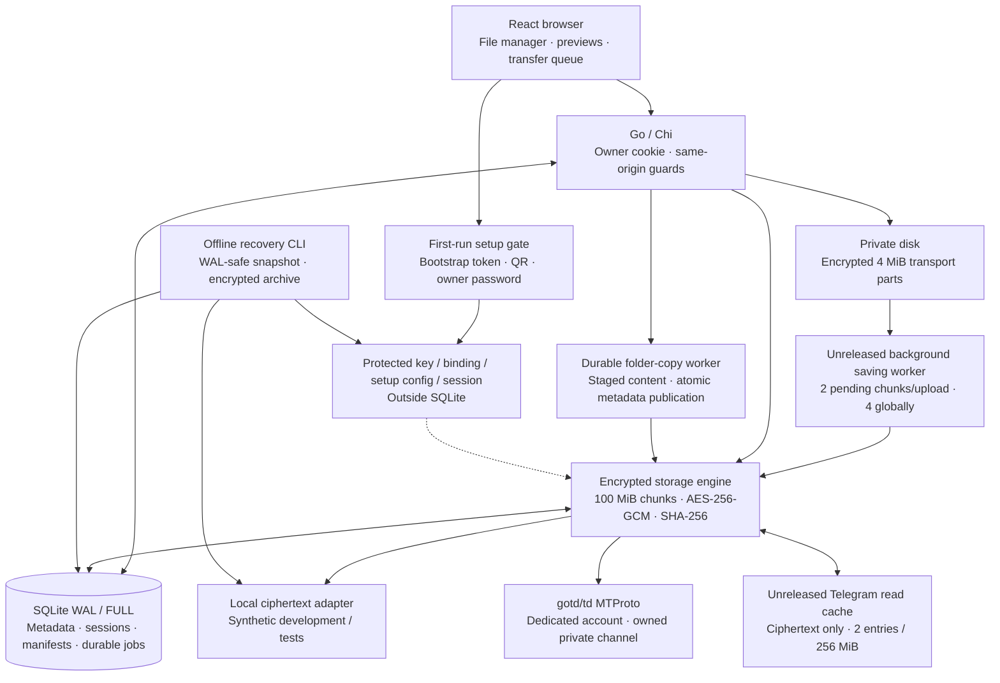

# Harbor — current project state and development handoff

> Audit snapshot before Milestones A and B. Transfer/preview fixes, offline storage maintenance, current candidate identity and newer verification supersede the corresponding gaps below; see [transfer engine final report](TRANSFER_ENGINE_FINAL_REPORT.md), [Milestone B](MILESTONE_B_FINAL_REPORT.md) and [v1.3 candidate](V1.3_RELEASE_CANDIDATE.md). Historical release/publication facts retain their recorded scope.

Audit date: 2026-10-22, Asia/Phnom_Penh. Source, Git, read-only GitHub/GHCR inspection and fresh isolated synthetic checks establish this report. Historical qualification is explicitly separate. No push, tag, publication, remote deployment, private-state inspection or live Telegram write was performed.

## 1. Executive summary

Harbor is an implemented single-owner private drive, not a prototype. It has guarded browser onboarding, Telegram MTProto/local encrypted storage, resumable uploads, a responsive file manager, previews, account settings, durable folder-copy jobs and encrypted offline recovery.

The actively maintained application is in `output/publication-gate/public-export/harbor`, not the original project root. Latest release is **v1.2.1**, not v1.0.0. The original development repository retains its separate history and immutable v1.0.0. GitHub source repository currently remains private; GHCR package is public. Those visibility facts were read from GitHub, not inferred from old plans.

The maintained workspace also contains **uncommitted, unreleased** background-upload and encrypted read-cache changes. They let browser parts advance while backend storage saves continue and reduce repeated remote range fetches. They do not change 100 MiB storage geometry, weaken final verification or establish new live Telegram throughput.

Fresh verification reproduced a first-cache-miss deadlock in those unreleased changes. A missing mutex unlock was fixed; an existing regression test now bounds the first fetch to five seconds. Published v1.2.1 has no such cache. No confirmed authentication bypass or silent data-loss defect was found in the reviewed source; this is not an independent security audit.

**Qualification is scoped:** local-adapter checks establish current code behavior; tagged Telegram tests use controlled doubles; historical live Telegram results establish only their recorded versions/images. Current private deployment and current live 100 MiB Telegram performance were not inspected.

## 2. Current version and Git state

| Tree / identity | Observed state at audit start |
| --- | --- |
| Original project root | Branch `codex/open-source-readiness`, HEAD `c84a687`; clean before requested handoff documentation |
| Original local release | `v1.0.0` → `f6c49fcd2a52e365c6cfe84395245112a105f929`; preserved |
| Maintained public export | Branch `main`, HEAD `9ff97a1d31d8d4ddcd2a49780632356ce5a2ef2c` |
| Latest annotated release | `v1.2.1` → source `dbbe3d02786b21a4ea3db3721947ab320ed0fe75`; tag object `2005ea13d28e7d0e5d7c79121c572a184fdcaea5` |
| Other export tags | `v1.0.1`, `v1.1.0`, `v1.2.0`; original `v1.0.0` is intentionally absent |
| Runtime / frontend default | `1.2.1`; dirty audit binaries retain this default and must not be mistaken for immutable release binaries |
| Export origin | `https://github.com/seakleangnhak/harbor.git` |
| Remote main | Independently queried; matches `9ff97a1` |
| Initial export changes | 21 modified tracked files and six new files, covering pipeline/cache/source tests/docs; preexisting work preserved |
| Audit edits | Cache deadlock fix and bounded regression; copy-crash fixture sized from active geometry; current-state report, reviewed fixture screenshots and narrowly corrected documentation; uncommitted |

No commits, tags or pushes were created during this audit. Neither working tree should be described as clean after adding this report. Continued application development should target the maintained export. Do not accidentally build/push the older original source tree.

Original history remains unsuitable for publication because its earlier privacy audit identified historical machine paths and personal Git metadata. That history was preserved, not rewritten. The approved export excludes it. This audit's fresh secret scans concern the maintained sanitized history/source, not a new private-runtime or original-history credential comparison. Historical go/no-go documents describe their dated gates; current remote facts in section 12 supersede obsolete visibility/version assumptions.

## 3. Current architecture



One modular monolith serves UI/API, pending-upload worker and folder-copy worker. No Redis, external queue, object service or separate database server. Diagram marks unreleased components explicitly; v1.2.1 storage commits remain synchronous.

## 4. Technology stack

| Area | Actual source / lockfile |
| --- | --- |
| Go | `go.mod`: Go 1.26.10 |
| HTTP | Chi v5.3.0, standard `net/http` |
| SQLite | modernc.org/sqlite v1.40.1, pure Go; WAL, FULL synchronization, foreign keys, 5-second busy timeout |
| Telegram | gotd/td v0.162.0, explicit `telegram` build tag |
| Cryptography | Standard AES-GCM/SHA-256/random; x/crypto bcrypt and scrypt |
| React / ReactDOM | Lockfile 19.3.1; manifest compatible range starts at 19.2.0 |
| TypeScript / Vite | Locked 5.9.3 / 7.3.7 |
| UI | Locked Tailwind 4.3.3; Radix/shadcn-style primitives, Lucide; custom evergreen/stone tokens |
| State / virtualization | TanStack Query 5.104.5 / Virtual 3.14.21 |
| PDF | PDF.js 6.4.299 with matching lazy worker and bundled font/CMap resources |
| Build/runtime images | Pinned Node 24, Go 1.26.10, distroless static Debian 12 nonroot |
| Automation | Python helper scripts, pinned actionlint, Playwright Chromium/WebKit and axe |
| License | MIT; third-party notices and redistributed PDF font-source obligations retained |

Installed host tool versions observed: Go 1.26.10, Node 26.5.0, npm 11.17.0, Docker 29.9.2, Compose 5.6.0. Production frontend build uses pinned Node 24, not host Node. Manifest ranges are not exact installed versions; use lockfiles.

## 5. Feature inventory and evidence rules

**PASS** means tested behavior within stated scope. **PARTIAL** means useful implementation with an important missing capability or qualification. **FAIL** means known reproducible broken behavior. **NOT TESTED** means implementation without adequate current execution evidence. **PLANNED** means absent functionality, not an owner-approved commitment.

The verification ledger in section 13 is authoritative for fresh execution. Historical release checks cannot upgrade an unreleased path to PASS.

| Feature | Status / scope | Evidence or boundary |
| --- | --- | --- |
| Single-owner login, authorization, cookie/origin guards | PASS, fresh controlled tests and browser/image checks | Source routes and auth/security tests; no signup or JWT issuance |
| Display name and password editing | PASS, fresh Go and Chromium/WebKit checks | Current-password verification; changes revoke all HTTP sessions |
| Web onboarding, local adapter | PASS, fresh exact audit image | Token gate, chosen password, setup lockout, readiness and restart |
| Browser Telegram QR / optional 2FA | PARTIAL | Source/controlled setup tests; current live web flow not exercised |
| Real MTProto storage | PARTIAL for current source | v1.0 exact-image live checksum/restore evidence retained; current live behavior not rerun |
| Local encrypted upload/download and byte ranges | PASS, fresh exact audit image | 104,923,157-byte multipart SHA-256, Range, auth, restart/recreation |
| 100 MiB multipart geometry / 4 MiB transport parts | PASS, fresh local controlled/image/browser checks | Legacy persisted geometry remains supported; total file ceiling 1 TiB |
| Reload/retry/resume | PASS, fresh controlled and browser checks | Missing original parts need file reselection; fully queued background files can finish without it |
| Background upload saves / next-file handoff | PARTIAL, unreleased | Fresh local overlap/checksum/retry tests pass; new worker mid-remote-save process-kill and live qualification remain |
| Folder hierarchy, CRUD, rename/move | PASS, fresh Go and browser checks | Breadcrumbs, cycle prevention, sibling-name conflicts |
| Folder copies | PASS within tested bounded synthetic scope | Durable job, atomic tree publication, 100 roots / 10,000 entries / depth 512 / eight unfinished jobs; process evidence in §13 |
| File-only copies | PARTIAL | Existing browser transfer path; no atomic multi-file transaction |
| Bulk selection/actions, clipboard, drag/drop | PASS within tested Go/browser scope | Shift/Cmd selection, copy/cut/paste, internal moves |
| Search, sort, type filters, recent | PASS within tested Go/browser scope | Global server search; command palette also searches loaded results |
| Favorites / Trash / restore | PASS, fresh Go/browser checks | Subtree Trash semantics and deletion-intent protection |
| Image / PDF / bounded text previews | PASS, fresh Chromium/WebKit fixture checks | Preview limits and cold-chunk latency remain |
| Audio/video previews | PARTIAL | Native browser codecs; optional MOV/seeking scenarios require fixture coverage |
| Read-cache optimization | PARTIAL, unreleased | Controlled tests pass after deadlock fix; current live cold/warm measurement remains |
| Transfer history / accurate progress / retry / cancellation | PASS within fresh controlled/browser scope | Sent, accepted, stored, verified states remain distinct |
| Upload pause | PARTIAL by design | Stops browser sender, not already queued backend storage; unsupported pause hidden |
| Downloads ≤32 MiB | PASS, fresh frontend/browser checks | Browser buffers bounded file and verifies SHA-256 before save |
| Downloads >32 MiB | PARTIAL | Native browser handoff; no in-app completion/hash/progress guarantee |
| Authenticated storage encryption/integrity | PASS, fresh synthetic checks; historical live scope separate | GCM and plaintext hashes; finalization bypasses cache |
| Encrypted backup/fresh restore | PASS for historical live and current synthetic scope | Current Python recovery checks pass; full Go outcomes in §13 |
| Mobile / light / dark / keyboard / scoped accessibility | PASS within fresh emulated/browser scope | 108 scoped axe checkpoints; no physical iOS/Safari or universal WCAG claim |
| Docker local persistent deployment | PASS, fresh ARM64 exact audit image | Nonroot/private permissions, guarded setup, restart/recreation and clean shutdown |
| Performance qualification | PARTIAL | Fresh local browser/cache measurements below; historical Telegram results are not current-source throughput |
| GitHub CI and GHCR | PASS for current committed HEAD / released image | Read-only remote APIs and registry index independently rechecked |
| Storage retry/recovery | PARTIAL overall | Extensive controlled tests; new worker mid-RPC SIGKILL and mixed-load qualification still absent |
| Live cross-datacenter retrieval | NOT TESTED | Protocol source and deterministic tests only |
| Sharing, roles, multiuser, collaboration | PLANNED/absent, intentional single-owner boundary | No endpoints/UI; roadmap requires owner decision |
| Content-key rotation, automatic off-provider mirror | PLANNED/absent | Existing restore cannot recover missing remote ciphertext |

## 6. Recent changes, separated by baseline

### Since original v1.0.0

- **v1.0.1:** MIT/community files, original SVG branding, safe screenshots, sanitized public source history, CI and guarded GHCR publication.
- **v1.1.0:** browser-first setup, owner-selected password, guarded Telegram QR/2FA, atomic private setup bundle, 100 MiB new storage chunks and legacy geometry compatibility, simpler Compose/Dokploy onboarding.
- **v1.2.0:** 4 MiB encrypted browser transport parts; resumable acceptance; repaired PDF/text/native media preview lifecycle; lazy thumbnails/MIME fallback; owner profile/password settings; responsive Account/Storage/Recovery; simplified environment example; CI cache/gate improvements.
- **v1.2.1:** PDF.js text cancellation supplies required `Error`, fixing intermittent WebKit stream-controller exceptions; repeated PDF lifecycle regressions; rolling Go compilation-cache retention.
- **After v1.2.1:** two documentation commits record release/registry evidence. No new tagged runtime release.

### Since latest tagged source: existing uncommitted work

- Durable background chunk queue, additive `canceling` intent and `storage_pending_chunks`; independent receiving/saving paths and joined startup/shutdown lifecycle.
- Frontend sender/monitor handoff allows later files to send while earlier files save/finalize; authoritative pending-state reconciliation and guarded retry/pause/cancel.
- Telegram-only bounded ciphertext cache and coalesced misses; every read still decrypts/authenticates/verifies.
- Remote completion verification moved outside API-wide metadata mutation lock; publication rechecks destination/conflicts/current storage identity.
- API opt-in `{background:true}` returns 202 after durable queueing; legacy synchronous endpoint retained.
- Meaningful queue/cache/API/browser tests added. These changes were initially source-reviewed but unexecuted because Docker was unavailable.

No feature removal, encryption-envelope rewrite, sharing implementation or deployment rollout was found in this delta. Audit remediation fixes the reproduced cache lock bug and a stale copy-crash fixture that no longer spanned multiple chunks, plus documentation drift; it does not redesign these changes.

## 7. Backend implementation

`cmd/drive` owns dotenv loading, startup, private data lock, stored configuration/key binding, CLI/setup and shutdown. `internal/api` owns owner auth, metadata, transfers, copy jobs and diagnostics. `internal/onboarding` owns bootstrap-only setup. `internal/storage` owns encryption, manifests, staging/adapters and readers. `internal/recovery` owns encrypted offline recovery.

API resources live under `/api/v1`: `/auth/*`, `/nodes`, `/folders`, `/uploads`, `/copy-jobs`, `/diagnostics`. `/health`, `/ready` and minimal setup status are public; ordinary private routes require owner session. Setup endpoints have an independent short-lived bootstrap-token gate. Legacy plaintext `/backup` intentionally returns 410 with encrypted-recovery guidance.

SQLite has one open connection. Metadata schema includes owner, owner_profile, hashed sessions, nodes, pending deletions and copy-job plan/state tables. Storage initializes uploads/chunks/transport-parts/pending queues and conditionally adds columns. API `PRAGMA user_version` remains 1; newer unknown versions fail closed. Migrations are currently additive initialization logic, not a sequence of individually numbered migrations. This is a maintainability/downgrade concern, not a discovered corruption failure.

Folder-copy plans snapshot names/hierarchy/favorites, keep internal stages hidden, resume bounded work and publish tree metadata in one transaction after validation. Cancellation/failure never deletes originals. Permanent deletion persists intent so interruption is retryable and restoration cannot race partial destruction.

## 8. Frontend implementation and UX assessment

`App.tsx` integrates session/setup, navigation, optimistic metadata changes and dialogs. TanStack Query caches server data; transfer hook owns persisted client queue and in-flight tasks. Components split into file browser, toolbar/sidebar, previews, transfers, onboarding, settings/account and command palette. Custom tokens preserve evergreen/stone identity with light/dark/reduced-motion styles; Radix supplies accessible primitives.

Implemented UX: virtualized list/grid above 100 entries; inline rename; optimistic create/rename/favorite rollback; per-folder preferences; sortable folders-first listing; Shift/Cmd selection; contextual menus; clipboard; internal drag/drop; inspector; breadcrumbs; 200 ms search debounce; mobile drawer and 450 ms long-press selection.

Preview capabilities:

- Images: fit/reset, 50–400% zoom, pan, next/previous and nearby strip. Grid thumbnails lazily fetch originals up to 8 MiB with two concurrent requests; no derivative-thumbnail service.
- PDF: lazy worker, 256 KiB range requests, page/fit/zoom controls; streaming/autofetch off; canvas/pixel limits; bounded accessible text. Image/font resources are local.
- Text/code: first 256 KiB; bounded token highlighting and React text output. HTML/XML/SVG are not active embedded documents.
- Audio/video: native controls, metadata preload, seek/loading/error/retry states; browser codecs govern support. Unsupported office/archive formats download instead.

UX issues/debt identified by source inspection: first preview may require 100 MiB authenticated fetch; native large downloads cannot report true completion in-app; metadata query requests up to 50,000 rows despite DOM virtualization; file-only copying traverses browser; theme/sidebar localStorage access is less defensive than other preferences. The last item is a source-based robustness candidate, not a reproduced critical bug. Screen-reader/physical-device/long-session browser-memory qualification is absent.

Fresh browser qualification passed eight suites across Chromium/WebKit with 112 captures and 108 scoped axe checkpoints. Eight manually reviewed Chromium views are retained in `docs/screenshots/current-state/`: 1440 × 900 light/dark file manager, folders, PDF and desktop transfers; 390 × 844 dark file manager, transfers and settings. Generated fixtures contain no personal content. No critical clipping, overlap or horizontal overflow was found in these reviewed views. Minor UX debt: transfer footer is dense; preview metadata can retain generic MIME despite correct format routing; narrow breadcrumbs truncate; lower settings fields need panel scrolling above a fixed footer. Older Phase 4 screenshots are historical illustrations, not evidence of this workspace.

## 9. Telegram storage implementation

gotd/td v0.162.0 runs one account client lifecycle. The dedicated account must already own an eligible private broadcast channel with auto-delete off and no linked discussion/public username. Private invite/message links resolve server-side access hash; optional expected channel ID must agree before writes. Setup does not silently join channels.

Session persistence uses private regular files, synced temporary write, atomic rename and directory sync. One data-directory lock prevents same-directory concurrent use. Copies of authorization in other directories still require operator serialization.

Storage documents contain opaque ciphertext, not source filenames/content. Durable `tg:<channel>:<message>` references locate messages; each download resolves current document location/file reference. Uploader uses 512 KiB MTProto parts and two part workers. Reused send-media random ID supports retry deduplication.

Six outer attempts, bounded exponential delay, terminal-error rejection and context-aware FLOOD_WAIT apply; size-scaled operation deadline is two to ten minutes. Native gotd retries/migration can add RPCs inside that deadline. Missing/revoked/channel-denied messages fail without plaintext success. Retry telemetry is process-local.

Same-DC reads use primary API; other DCs use media-only connections. Secondary media FILE_MIGRATE delegates once to gotd primary authorized routing. Deterministic tests cover routing, reference refresh, cancellation, truncation and missing/access-denied objects. **Live cross-DC retrieval remains NOT TESTED.** No traffic was generated to force Telegram placement or rate restrictions.

## 10. Security and encryption

Single owner authenticates against bcrypt hash. Web tokens are random 256-bit opaque values; SQLite holds only SHA-256 token hashes and fixed seven-day expiry. Cookies are HttpOnly, host-only, SameSite=Strict; Secure must match HTTPS deployment. Same-origin/Fetch Metadata checks protect mutations. Login/password attempts are limited per actual peer, ignoring spoofable forwarding headers; limiter is process-local and proxy users share quota.

Profile validation is 1–80 UTF-8 characters, no controls. Password changes require current password and 12–72 UTF-8 bytes, update hash and revoke all sessions atomically. Saved initialization passwords never reset an existing account. No email reset, role management or separate global-session UI exists.

Content key is 32 random bytes outside SQLite; storage binding includes key fingerprint, adapter and channel. Existing key/binding/DB loss fails closed. `HD01` chunk envelope uses fresh random 96-bit nonce, AES-256-GCM and upload/chunk AAD; 32 bytes total envelope overhead. `HP01` transport parts use distinct part AAD. Plaintext chunk SHA-256 is verified on reads; full remote re-read and complete SHA-256 precede file publication. Cache hits still authenticate into private caller buffers; final verification bypasses cache.

Protected directory/file modes are 0700/0600. Symlink/nonregular secret paths are rejected. SQLite names, hierarchy, sizes and hashes remain plaintext on trusted host. Keys/session exist on that host; disk encryption/host isolation still matter. Container permissions do not defend against host root or malware running as owner.

Recovery is an offline CLI, not a browser archive endpoint. `HBRBK002` archives use scrypt (N=32768, r=8, p=1), a fresh per-archive salt/key, and ordered AES-256-GCM records with authenticated final termination. SQLite's supported backup API creates a WAL-safe in-memory snapshot, capped at 256 MiB, so plaintext backup metadata is not staged on disk. Archive includes database/manifests, content key, allowlisted recovery configuration and necessary Telegram session; local-adapter blobs are included, Telegram ciphertext is not mirrored. Verification rejects incorrect passwords, truncation, corrupt members, missing key/binding/config, unsafe paths and unsupported shapes. Restore validates into private staging and exclusively publishes a new nonexistent destination; it revokes restored HTTP sessions by default. Pending browser part files and disposable read cache are omitted. Existing original authorizations must never run concurrently with their restored copies. Fresh local exact-image archive/restore/checksum passed; historical live restored-Telegram evidence retains its own version scope.

Fresh redacted Gitleaks scans: sanitized history (33 commits) and final current source snapshot (338 files) returned zero findings. This is detection evidence, not proof of absence of every secret. No private `.env`, content key, session, database or backup was read. No new vulnerability-database scan was run; earlier phase scanner results retain historical scope.

## 11. Docker and deployment

Production Dockerfile builds frontend and pure-Go Telegram-enabled backend/recovery CLI in separate pinned stages. Distroless runtime is nonroot UID/GID 65532, with no shell; `/app/drive` is entrypoint, `/data` persistent state, health command included. Build context excludes environment files, databases, sessions, keys, backups, dependency directories, output and Git metadata. No runtime secrets are build arguments.

Local Compose publishes loopback only, drops capabilities, sets no-new-privileges, read-only root, 128 MiB tmpfs, two CPUs, 768 MiB hard memory limit and 128 PIDs. Go `GOMEMLIMIT=512MiB` is a soft runtime memory target, not a Docker reservation. Dokploy Compose uses external persistent volume, one replica, secure cookies and an HTTPS same-origin proxy with no direct host port.

Fresh isolated ARM64 image smoke passed encrypted multipart checksum, range/auth/CSRF, guarded onboarding and permanent setup lockout, private permissions, persistence across restart/recreation, legacy init compatibility and clean shutdown. Current-source AMD64 rebuild is not implied by ARM64 success; released v1.2.1 has independently rechecked dual-architecture registry descriptors and historical actual-image smokes.

An existing local Harbor container was observed and left untouched. No authenticated request was made to it, no SSH/Dokploy deployment was inspected, and its reported source/image was not assumed. Published package availability does not prove any server has upgraded.

## 12. GitHub Actions and GHCR

Read-only remote checks confirmed `seakleangnhak/harbor` is **private**, default `main`, latest release v1.2.1; package `harbor` is **public** and linked to that repository. No visibility changes were made.

- Main CI [39666607670](https://github.com/seakleangnhak/harbor/actions/runs/39666607670) is completed/success at exact committed HEAD `9ff97a1`, with backend, frontend and native AMD64/ARM64 image jobs all successful.
- Tagged-source CI [39661996927](https://github.com/seakleangnhak/harbor/actions/runs/39661996927) and publisher [39665307955](https://github.com/seakleangnhak/harbor/actions/runs/39665307955) remain historical v1.2.1 receipts, not CI for dirty workspace.
- GHCR `1.2.1` was freshly inspected: index `sha256:87553d2564da6f990e6be18a7b8946833b7600a22b0287d72ad6042077253a74`.
- AMD64 child `sha256:40f298717bfe147bd5f3877919055810d1086c4386c8f90bafee336bce269a67`; ARM64 child `sha256:56c95192d0a63d1de43e1cf8cc4c64258f092c63b915ef821a16e682ebf2ee2f`; two additional attestation manifests are not extra CPU platforms.

CI is read-only on PR/main; locked dependencies, Go tests/race/vet, frontend tests/types/build, actionlint/policy, deterministic executables, image smoke and offline Chromium/WebKit run. Actions/base images are pinned. Publishing has owner/triggering-owner stable annotated-tag gates, exact-main-CI proof, package identity/visibility checks and only job-scoped `packages: write` with GITHUB_TOKEN. PRs cannot publish. Stable version/minor/latest aliases, OCI metadata, SPDX SBOM and minimal provenance are produced. Cryptographic attestation signature verification remains NOT TESTED.

## 13. Tests and actual results

Fresh audit checks run only synthetic fixtures in isolated offline, read-only, nonroot containers with bounded CPU/RAM/PIDs/tmpfs; build stages may fetch locked public dependencies without runtime secrets. Trusted static tools and read-only GitHub/registry queries run outside target containers. Evidence stays ignored under `output/current-state/` in maintained export.

| Check | Actual audit result |
| --- | --- |
| Git source/history inspection | PASS; two separate trees and dirty export identified |
| Go formatting / diff hygiene | PASS, fresh checks |
| First focused backend run | FAIL: cold-cache self-deadlock; synthetic test stopped with SIGQUIT and stack retained |
| Cache fix | Missing cold-miss unlock fixed; independent source review passed; bounded first-fetch regression added |
| Focused/full default Go tests | PASS; storage/API focus plus every default package, `-count=1` |
| Full default Go race tests | PASS; API 114.955 s, recovery 51.160 s, storage 13.512 s; no race report |
| Default vet / module verification | PASS; `go vet -p 1 ./...`, `go mod verify` |
| Telegram-tagged race | NOT TESTED at runtime: three compile attempts failed with `github.com/gotd/td/tg: ... compile: signal: killed`; Docker VM has 3.825 GiB RAM. Sequential retry, lower GC target and serial compiler did not resolve resource limit. These are failed builds, not passing tests or observed application assertions |
| Production-flag Telegram-tagged tests | PASS, fresh `-count=1` execution using exact-source production dependency cache; API 8.252 s, recovery 4.369 s, storage 4.410 s |
| Telegram-tagged vet | PASS with production compilation flags and dependency cache |
| Frontend tests | PASS: 48 tests, zero failures/skips |
| Frontend explicit typecheck / production build | PASS, pinned Node 24; existing bundle warning |
| Python helper tests | PASS: 58 tests, 13.180 seconds; encrypted recovery success and expected rejection paths included |
| README / workflow policy / actionlint | PASS: 34 local README resources, heading anchors, three safe SVGs; no linter diagnostics |
| Sanitized history/current source secret scans | PASS: zero redacted findings; 33 commits and final 338-file snapshot |
| Compose local/Dokploy syntax | PASS with empty environment file; no secret interpolation output |
| Cache-fixed exact ARM64 audit-image local smoke | PASS: 104,923,157 bytes, SHA-256 equal, Range, restart/recreation, auth/CSRF/onboarding/private modes/clean shutdown, at 768 MiB container limit; local adapter bypasses cache |
| Current browser suites | PASS: four suites each in Chromium/WebKit, 112 screenshots, 108 scoped axe checkpoints, generated fixtures only |
| Browser transport / background handoff | PASS: 105,906,299 bytes, two storage chunks, requests ≤4,194,304 bytes; injected part/503 failures, retry, graceful process restart/reload/reselection; next small file begins before prior publication; both checksums match |
| Process acceptance / encrypted recovery | PASS: owner/origin guards, interrupted upload, process restart, idempotent retry, full SHA-256 and cross-chunk Range, hierarchy/favorites/Trash, backup/fresh restore, old-session and logout revocation |
| Actual folder-copy process termination | PASS: 209,715,217-byte fixture; SIGKILL after 104,857,600 acknowledged bytes/one chunk; restart completed three chunks, SHA-256 equal, hidden partial tree, cancellation cleanup and original retained |
| Repaired copy-helper tests | PASS: two focused fixture tests after active-geometry repair |
| Focused WebKit visual replay | PASS: suspicious pale light-theme heading did not reproduce; computed heading/root/body color `rgb(38, 55, 45)` and initial/settled captures correct; no speculative source fix |
| Fresh live Telegram / deployed server / cross-DC | NOT TESTED; private state untouched |

The compiler resource failures remain recorded even where default or production-image checks pass. Fresh default-race coverage and earlier released Telegram-race success do not imply a successful current tagged-race run. A cold non-race tagged compile also exceeded VM memory; reusing the unchanged production dependency compilation cache allowed fresh tests to execute. First cached run's fresh restore failed in an undersized 256 MiB `/tmp`; rerunning with the fixture's 2 GiB bounded scratch as TMPDIR passed. No source change was needed for that environmental failure, and the failed restore published no destination. Runtime/source hashes in `cached-build-source.txt` match the tested audit image executables and audit fingerprints.

Historical v1.2.1 evidence: 41 frontend tests, 58 Python tests, all Go/race/vet variants, native AMD64/ARM64 image smokes, eight Chromium/WebKit suites, 110 PNGs and 106 scoped axe contexts. Current remote HEAD success was independently checked, but old counts cannot describe dirty-source checks.

Exact current audit image: local index `sha256:92b592fc17829f7f3c2bd4610f9476c688c28c9bc733a63bb979ce2f7338b96f`, ARM64 runtime manifest `sha256:0bb5014160294a2a324bf726bc442d044910c3b24aaca21a7ffda16fb344af10`. This is a dirty-source local image, not a release or GHCR artifact. Its default displayed version remains 1.2.1. Source fingerprints are retained in `output/current-state/audited-source.json`; exact-image extracted executables were used for process acceptance/copy recovery. Documentation/helper-only edits after the build do not change those runtime executables.

Actual command families (executed inside isolated fixtures, not directly against owner state):

```sh
go test -count=1 -p 1 -timeout 8m ./...
go test -count=1 -p 1 -race -timeout 8m ./...
go vet -p 1 ./...
go mod verify
CGO_ENABLED=0 GOFLAGS='-buildvcs=false -trimpath' go test -count=1 -p 1 -tags telegram -timeout 8m ./...
CGO_ENABLED=0 GOFLAGS='-buildvcs=false -trimpath' go vet -p 1 -tags telegram ./...
npm --prefix web test
npm --prefix web run typecheck
npm --prefix web run build
python3 -m unittest discover -s scripts -p '*_test.py'
python3 scripts/acceptance.py --binary /app/drive
python3 scripts/phase5_copy_check.py --binary /app/drive
python3 scripts/ci_check.py docker-smoke --image harbor:state-audit --platform linux/arm64 --version 1.2.1
node /checks/browser_check.cjs chromium all
node /checks/browser_check.cjs webkit all
docker compose --env-file /dev/null -f compose.yaml config --quiet
docker compose --env-file /dev/null -f compose.dokploy.yaml config --quiet
```

Current browser SHA-256: `6029196e8fead8bd9005dd9f756b85228a075503dada2f5de6dbc7ab6e9f6994`. Core evidence: `backend-check.log` (reproduced cache deadlock), `backend-fixed.log` (fixed default suites plus first tagged compiler failure), `backend-tagged-retry.log`, `backend-tagged-serial.log`, `backend-vet-benchmark.log`, `backend-tagged-production-flags.log`, `backend-tagged-cached.log`, `backend-tagged-cached-fixed.log`, `cached-build-source.txt`, `frontend/checks.log`, `process-checks.log`, `docker-smoke-fixed.json`, `browser/summary.json`, `browser/visual-probe-output.log`, and `operations/` under `output/current-state/`.

## 14. Performance evidence

Historical Phase 3: 100 MiB Telegram upload observed 1.121734 → 1.354059 MiB/s. Historical v1.0 exact image: 100 MiB upload 1.626430 MiB/s including final verification, download 4.212658 MiB/s; startup 0.760 seconds; sampled idle working set 5.059 MiB and transfer working set 38.270 MiB. Those used 4 MiB storage chunks, different source/network conditions and coarse samples; they do not establish current 100 MiB chunk capacity.

Fresh current frontend assets: main JS 561,871 bytes (178.92 kB gzip), lazy PDF 517,237 bytes (156.89 kB gzip), PDF worker approximately 1.32 MB; `dist` about 7.7 MiB by rounded `du`. Existing Vite >500 kB warning remains. No new animation/dependency layer was added.

Fresh local 1,000-folder browser fixture: Chromium creation 341 ms/reload-and-load 218 ms; WebKit 382 ms/226 ms. Both render 17 list rows and 50/80/50 grid cards across scroll positions, with no overlap, working End-key navigation and no automatic file-content requests. These are local synthetic timings, not WAN/Telegram or 50,000-entry benchmarks.

Fresh ARM64 cache benchmark used three single-iteration samples per mode: four 256 KiB ranges from one 100 MiB synthetic object with injected 20 ms adapter latency. Disabled: 386.60–388.97 ms per range sequence (median 387.47 ms), four remote Gets/~400 MiB. Enabled: 362.19–390.62 ms (median 363.19 ms), one remote Get/~100 MiB. Fetch count/remote bytes decrease 75%; three noisy local timings do not establish a reliable live latency improvement. Envelope adds 32 bytes per remote object to rounded MiB figures. Both modes cumulatively allocate ~419.5 MB per sequence; cache does not remove repeated full-chunk authentication allocations. B/op is not peak RAM; Go's response MB/s is decimal and not Telegram bandwidth. Command: `go test -p 1 ./internal/storage -run '^$' -bench '^BenchmarkReadCacheRangeSequence100MiB$' -benchtime=1x -count=3 -benchmem`.

Current live throughput, real cold/warm Telegram preview latency, sustained mixed load and lifetime memory peak remain NOT TESTED. No speculative performance rewrite was made from historical or synthetic figures.

## 15. Known bugs and limitations

1. Cold-cache deadlock reproduced and fixed here; focused, full default and default-race checks pass. Current live cache qualification remains separate.
2. Live cross-DC, current live browser Telegram setup and new 100 MiB throughput remain unverified.
3. Cold authenticated range can require a full 100 MiB chunk; cache helps repetition only.
4. Remote-write/SQLite-commit crash window can leave untracked ciphertext. No automatic remote GC; never bulk-delete channel messages.
5. Recovery archives preserve Telegram references/config/key/session, not an off-provider content copy. Account/channel/message loss remains unrecoverable from metadata alone.
6. New background worker restart tests include injected/reopened durable states; they are not an actual worker SIGKILL during remote saving. Mixed copy/upload/preview stress is absent.
7. Queue slots bound active reservations, not arbitrary crash leftovers; four abandoned pending reservations can apply global backpressure until recovery/cancellation.
8. Older binaries/clients do not understand pending queue; finish/cancel pending uploads before downgrade. Backup omits staged transport parts and read cache.
9. File-only copies and native downloads retain limits described above. No transcoding/Office preview/editor.
10. Backup memory/scale ceilings, host-readable metadata, process-local throttling, no content-key rotation, no independent security audit/public-internet qualification.
11. Browser automation is Chromium/WebKit with emulated mobile, not physical Safari/iOS; optional codecs/assistive technology/long-session memory remain outside coverage.

No other reproducible critical defect was confirmed by this audit. Source review alone does not prove absence.

## 16. Technical debt

| Debt | Consequence | Small next step |
| --- | --- | --- |
| Original/export parallel trees and historical ownership blocks | Easy to build wrong version or follow obsolete instructions | Make maintained-tree entry point explicit; simplify superseded instructions in separate reviewed change |
| Additive schema changes retain version 1 | Downgrade/migration reasoning depends on code knowledge | Inventory migration order and define future version fencing before another schema feature |
| Large transfer hook and monolithic integration component | Concurrency/lifecycle changes require careful review | Add outcome-focused failure coverage before considering extraction |
| 50,000-row metadata fetch despite virtualized DOM | Browser memory/query latency grows with directory size | Measure large real metadata fixtures; add server-backed pagination only if needed |
| Original-file thumbnail downloads | Unnecessary Telegram reads and cold-preview cost | Measure bandwidth; consider bounded encrypted derivative thumbnails |
| Historical reports overlap current guidance | Old password/copy/version claims mislead planning | Current report is entry point; keep historical receipts clearly labeled |
| Runtime build version lacks dirty-source identity by default | Audit binary can display released version while containing new code | Tie future builds to source revision/dirty state without moving existing release tags |

## 17. Missing features, not assumed commitments

No multiuser/roles/public sharing, collaborative editing, content-key rotation/re-encryption, web-executed recovery, automatic backup scheduling/retention/off-host upload, independent Telegram-content mirror, derivative thumbnail server, media transcoding, full Office preview or session inventory UI. Password changing and all-session revocation on change already exist and should not be proposed as missing.

## 18. Ranked development priorities

Scores are planning judgments, not benchmark facts. Impact/reliability/security/performance use high/medium/low; complexity and regression risk assess smallest useful delivery.

| Rank / workstream | Improvement | User impact | Reliability | Security | Performance | Complexity / risk |
| --- | --- | --- | --- | --- | --- | --- |
| 1 / A | Run current tagged race with adequate compiler RAM; finish remaining pipeline/cache gates | High | High | Medium | High | Medium / high concurrency risk |
| 2 / A | Controlled current-image live Telegram checksum and 100 MiB cold/warm benchmark | High | High | Medium | High | Medium / low with isolated authorization handoff |
| 3 / A | Actual pending-worker process termination, retry/cancel and queued-restore drill | High | High | Medium | Medium | Medium / medium |
| 4 / A | Mixed upload/copy/preview memory/backpressure measurements at Compose limits | High | High | Medium | High | Medium / medium |
| 5 / B | Measure/reduce cold preview and original-thumbnail fetch cost | High | Medium | Medium | High | Medium / medium |
| 6 / C | Optional scheduled verified backup/off-host runbook with retention guardrails | High | High | High | Low | Low–medium / low |
| 7 / C | Explicit off-provider protected content-export/recovery strategy | High | High | High | Low | High / medium |
| 8 / B | Large-folder query/memory profiling and pagination if measured need | Medium | Medium | Low | High | Medium / medium |
| 9 / B | Physical Safari/macOS/mobile and keyboard/screen-reader qualification | Medium | Medium | Medium | Medium | Medium / low |
| 10 / A | Source identity/migration/downgrade documentation and fencing | Medium | High | Medium | Low | Low–medium / medium |

## 19. Next three milestones

**Milestone 1 — Qualify existing transfer changes.** Preserve passing synthetic/default-race/browser/image checks, run tagged race with adequate RAM, add actual upload-worker interruption and resource-bound mixed workloads; then owner-authorized isolated Telegram checks with exact image and controlled files. Publish no new tag until reviewed. Exit: integrity/queue/cancel/restart evidence, measured cold/warm ranges, honest limits and immutable source identity.

**Milestone 2 — Improve preview/file-manager responsiveness from measurements.** Profile full-chunk first-byte cost, thumbnail traffic and large-directory metadata. Choose smallest measured fix; preserve AEAD-before-plaintext and current UX. Extend browser/mobile/accessibility checks. Exit: documented before/after latency/request/memory results with no integrity regression.

**Milestone 3 — Operational resilience and selected advanced features.** Owner selects backup cadence/destination and off-provider content strategy. Add opt-in automation or protected content export first; session inventory is optional. Keep single-owner/no-sharing architecture unless owner deliberately changes product scope. Exit: fresh-environment drill and tested operator workflow, not a new infrastructure stack.

## 20. Architectural decisions requiring owner input

- Confirm maintained export as sole future development tree and how original historical archive should be presented.
- Approve release only after reviewing new pipeline failure/resource evidence; no version/tag/publication approved by this audit request.
- Choose acceptable preview first-byte latency and local encrypted cache/derivative storage budget before changing encryption granularity.
- Choose backup cadence, off-host destination, recovery-password custody and whether provider-loss recovery requires independent content export.
- Decide whether use remains single owner on trusted/private HTTPS access. Public-internet or multiuser scope requires separate threat model/qualification, not a cosmetic deployment flag.
- Choose practical folder/metadata scale targets before lifting 10,000-entry copy or 50,000-row listing ceilings.

### Review map

Start with this report, `docs/TRANSFER_PIPELINE.md`, `docs/ARCHITECTURE.md`, `docs/API_CONTRACT.md`, `docs/KNOWN_LIMITATIONS.md`, `docs/RELEASE_1.2.1.md` and `docs/PRODUCTION_OPERATIONS.md` in maintained export. Runtime entry points: `cmd/drive/main.go`, `internal/api/{server,auth,transfers,copy_jobs}.go`, `internal/storage/{engine,transport,pipeline,read_cache,reader,telegram}.go`, `internal/recovery/`, `internal/onboarding/`, `web/src/{App,use-transfers,transfer-utils}.tsx`/`.ts`, preview/settings components, Docker/Compose and `.github/workflows/`.

The same final report is saved at original root `docs/CURRENT_PROJECT_STATE.md` for handoff discovery; source references above mean maintained export unless explicitly marked original. Original application source, deployment, keys, DB, Telegram session and v1.0.0 remain preserved.
